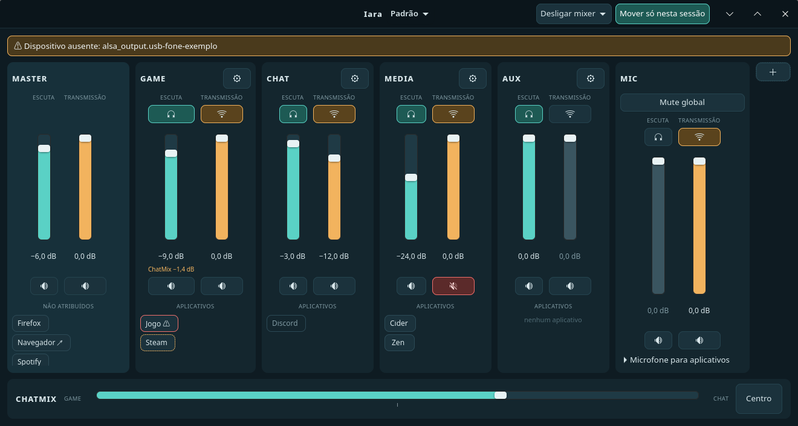

# Iara

Mixer e roteador de áudio avançado para Linux, em Rust e GTK4 sobre PipeWire. Licença MIT.

Inspirado em soluções de hardware como GoXLR e Elgato Wave Link, o **Iara** organiza o áudio do seu sistema dividindo aplicativos em canais virtuais dedicados (Mídia, Jogos, Voz, Auxiliar, Navegador), permitindo criar mixagens independentes para seus fones de ouvido e para sua transmissão, sem travamentos de som nem latência perceptível.



---

## Recursos Principais

- **Submixagem Estilo GoXLR / Wave Link**: Separação clara entre a mixagem do seu fone e o que vai para a transmissão ou gravação.
- **Roteamento Dinâmico de Aplicativos**: Arraste etiquetas de programas entre canais ou use regras salvas por aplicativo; fluxos novos são capturados automaticamente pelo canal *Não Atribuídos*.
- **Curva Natural de Fader (Quadratic Taper)**: Resposta perceptiva agradável aos ouvidos ($dB = -60 \cdot (1 - p)^2$), oferecendo controle fino na faixa comum de operação (−15 dB a 0 dB) e silêncio absoluto no piso.
- **Sincronização de Volume de Hardware**: Controle direto do ganho do DAC/fone físico pela interface, sincronizado bidirecionalmente com teclas multimídia e o WirePlumber (`wpctl`).
- **Resolução Inteligente de Dispositivos USB**: Reconhece seus fones e microfones favoritos mesmo se trocarem de porta USB ou de índice no barramento.
- **Ocultação de Nós Internos**: O desktop e o painel de áudio do sistema enxergam apenas a saída principal do mixer (`iara.unassigned`), mantendo a lista de dispositivos limpa.
- **Medidores de Pico ao Vivo**: RMS/Peak integrados diretamente no trilho dos sliders com animação suave e indicação visual de saturação (*clipping*).

---

## Organização do Projeto

- [`iara-core`](file:///home/ocnaibill/repos/iara/crates/iara-core): Domínio compartilhado, curva natural de fader (`taper`), modelo de ganhos, fórmula do ChatMix, medidores de nível e plano de topologia (`topology`: perfil → nós, ramos e diff).
- [`iara-store`](file:///home/ocnaibill/repos/iara/crates/iara-store): Persistência atômica em TOML (perfis, configuração, histórico de até 50 revisões com rollback), cópia válida anterior de segurança e exportação/importação.
- [`iara-ipc`](file:///home/ocnaibill/repos/iara/crates/iara-ipc): Protocolo D-Bus fortemente tipado (`dev.iara.Mixer1`), com servidor assíncrono e cliente reativo.
- [`iara-audio`](file:///home/ocnaibill/repos/iara/crates/iara-audio): Motor PipeWire em processo nativo; sincronização de nós, loopbacks, volume de hardware (`wpctl`), medidores em tempo real e captura de fluxos.
- [`iara-service`](file:///home/ocnaibill/repos/iara/crates/iara-service): Daemon de sessão que gerencia o ciclo de vida do mixer, supervisão do motor, reconexões, autosave e serviço D-Bus.
- [`iara-ui`](file:///home/ocnaibill/repos/iara/crates/iara-ui): Interface gráfica moderna em GTK4 com visualização em colunas, arrastar e soltar de aplicativos e acessibilidade total via teclado e leitor de tela.

---

## Requisitos e Instalação

### Instalação Rápida (Recomendado)

O repositório inclui o script [`setup.sh`](file:///home/ocnaibill/repos/iara/setup.sh) que verifica os pré-requisitos, instala os pacotes do sistema e configura a toolchain Rust via `rustup`:

```sh
# Diagnosticar dependências
./setup.sh --check

# Instalar requisitos essenciais
./setup.sh

# Instalar também ferramentas para suíte de provas e medições
./setup.sh --with-tests
```

### Dependências de Sistema Manuais

- **Arch Linux / CachyOS / Manjaro**:
  ```sh
  sudo pacman -S --needed base-devel pkgconf clang pipewire wireplumber gtk4
  # Opcionais (para testes e provas completas)
  sudo pacman -S --needed sox xdotool xorg-server-xvfb openbox python-gobject
  ```

- **Ubuntu / Debian / Pop!_OS**:
  ```sh
  sudo apt update && sudo apt install -y build-essential pkg-config clang libclang-dev libpipewire-0.3-dev libgtk-4-dev pipewire wireplumber
  # Opcionais (para testes e provas completas)
  sudo apt install -y sox libsox-fmt-all xdotool xvfb openbox python3-gi
  ```

- **Fedora**:
  ```sh
  sudo dnf install -y @development-tools pkgconf-pkg-config clang clang-devel pipewire-devel gtk4-devel pipewire wireplumber
  # Opcionais (para testes e provas completas)
  sudo dnf install -y sox xdotool xorg-x11-server-Xvfb openbox python3-gobject
  ```

---

## Compilação e Instalação

Para compilar e instalar o Iara no seu sistema:

```sh
# Compilar binários em modo release
cargo build --workspace --release

# Instalar no sistema (/usr/local) com desktop entry, ícone e unit systemd
sudo make install

# Ou instalar apenas para o usuário atual (~/.local):
make PREFIX=$HOME/.local install
```

Para habilitar e iniciar o serviço de áudio em segundo plano com a sua sessão:

```sh
systemctl --user enable --now iara.service
```

---

## Uso e Teste

### Teste Humano Rápido (Ambiente Isolado)

Para experimentar o Iara com segurança sem alterar a saída padrão do seu sistema:

```sh
tools/teste-humano.sh
```

Para testar no modo completo (tornando o Iara a saída padrão do sistema):

```sh
tools/teste-humano.sh --completo
```

Se o serviço for encerrado anormalmente e você precisar restaurar a saída de áudio original do sistema:

```sh
iara-service --restore-default
```

### Modo de Demonstração (Sem Serviço)

Para ver a interface com aplicativos simulados e capturar telas:

```sh
# Interface interativa de demonstração
cargo run -p iara-ui --features gtk-ui -- --demo

# Gravar captura de tela da interface e sair
cargo run -p iara-ui --features gtk-ui -- --demo --screenshot captura.png
```

---

## Verificação e Suíte de Testes

O Iara possui uma suíte rigorosa de testes unitários e de integração de ponta a ponta:

```sh
# Testes unitários do workspace
cargo test --workspace --all-features

# Verificação estrita de linters
cargo clippy --workspace --all-targets --all-features

# Provas reais de acessibilidade e entrada de teclado/mouse
tools/provas/20-janela-entrada-real.sh

# Provas em ambientes privados isolados (PipeWire, D-Bus e Xvfb próprios)
tools/provas/22-medidores-motor.sh
tools/provas/23-medidores-janela.sh
tools/provas/24-medidores-custo.sh
```

Documentação adicional de arquitetura e decisões de engenharia estão em [`docs/especificacao.md`](file:///home/ocnaibill/repos/iara/docs/especificacao.md) e [`docs/provas/registro.md`](file:///home/ocnaibill/repos/iara/docs/provas/registro.md).
